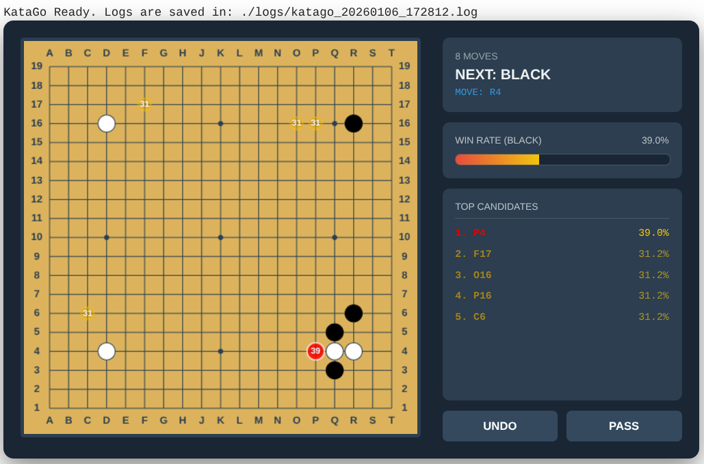

# katago-on-colab

KataGo を Google Colaboratory で簡単に動かすためのノートブックです。

A notebook for easily running KataGo on Google Colaboratory.

## 日本語

### はじめに

KataGo を利用する際に GPU を利用したいことがあると思います。
GPU マシンを用意するのも、難しい設定を行うのも大変な場合があるため、Google Colaboratory で動作するようにしました。

単に動かすだけではなく、GUI で碁盤をクリックして操作できるようにしてあります。

### 事前設定

必ず Runtime の設定で GPU を選択してください。
L4 でも十分です。

### 使い方

基本的には上から下まで順番にセルを実行することで利用できます。

**0. 準備するもの**

- Google アカウント (Colab の利用に必要です)
- ブラウザだけで動きます。パソコンへのインストールは不要です

**1. ノートブックを開いて GPU を有効にする**

1. 上の「Open In Colab」バッジをクリックすると、このリポジトリのノートブック **`katago-on-colab.ipynb`** が Google Colab で開きます
2. メニューの「ランタイム」→「ランタイムのタイプを変更」→ ハードウェア アクセラレータで **GPU (L4 推奨)** を選択して保存

**2. セルを上から順に実行する**

セル (コードのかたまり) は、左端にある **再生ボタン (▶)** をクリックすると実行できます。
初回の実行時に「警告: このノートブックは Google が作成したものではありません」と表示されたら、**「このまま実行」** を選んでください (このリポジトリのコードを実行して良いかの確認です)。

| セル | 内容 |
|---|---|
| KataGo Configuration | KataGo 本体とモデルの URL 設定。**既定のままで OK** |
| モデルの選択 (任意) | 最新のネットワーク一覧をドロップダウンから選択。スキップ可 |
| 1. インストール | 依存ライブラリ・KataGo 本体・モデルのダウンロード (数分かかります) |
| 2. 設定ファイルの作成 | gtp.cfg を作成。そのまま実行 |
| 3. ベンチマーク (任意) | 動作確認。スキップ可 |
| 4. 設定の自動調整 (任意) | 最適なスレッド数を計測。表示された推奨値を 2 の `numSearchThreads` に反映して再実行 |
| 5. 実行 | KataGo を起動して GUI を表示 |
| 6. 終了処理 | 使い終わったら実行してプロセスを掃除 |

**3. GUI の使い方**

- **着手**: 碁盤をクリック (黒白交互)。**UNDO** で一手戻し、**PASS** でパス
- **棋譜の保存・読み込み**: **SAVE SGF** でここまでの棋譜を SGF ファイルとしてダウンロード。**LOAD SGF** で手持ちの SGF ファイルを読み込んで、その続きから検討できます
- **新規対局**: **NEW GAME** で盤面を初期化して最初から打ち直せます (間違って消さないよう確認ダイアログが出ます)
- **候補手**: 盤上の色付き丸が候補手 (赤いほど有力、数字は手番側の勝率)。右のリストには勝率と探索数 (visits) が表示されます
- **常時解析**: 盤面を表示している間、裏で解析が回り続けます。見ているだけで候補手・勝率がどんどん深まり、現局面の総探索数は「N visits」表示で確認できます
- **GPU 表示**: 情報パネル下部に GPU の種類と使用率。使用率が緑 (30%以上) なら解析が正常に働いています
- **勝率バー**: 白地に黒い部分が黒の勝率です

**4. 終わったら**

「6. 終了処理」セルを実行し、Colab の「ランタイム」→「ランタイムを接続解除して削除」を実行してください (接続中はコンピューティングユニットを消費し続けます)。

### トラブルシューティング

**`error while loading shared libraries: libcublas.so.12` などのエラーで起動しない**

Colab の環境は 2026-10 時点で CUDA 13 に更新されており、CUDA 12 向けの KataGo (v1.16.4 以前の既定設定) は動きません。
保存しておいた古いコピーではなく、上の「Open In Colab」バッジから最新のノートブックを開き直してください。`KATAGO_RELEASE_URL` を自分で変更している場合は、ファイル名に `cuda13` を含むビルドを選んでください。

**最新のモデル (`tf3-` で始まるもの) を選ぶと起動しない**

2026-08 以降の最新モデルはトランスフォーマー型で、KataGo **v1.17.0 以降**でないと読み込めません。`KATAGO_RELEASE_URL` を古いバージョンにしている場合は、最新版に戻してください。

**`nvidia-smi: command not found` と表示される / 極端に遅い**

GPU ランタイムに接続されていません。「ランタイム」→「ランタイムのタイプを変更」で GPU を選び直してください (「使い方」の 1. を参照)。

**「KataGo の起動に失敗しました」と表示される**

表示されたログファイル (`./logs/katago_*.log`) にエラーの内容が出ています。左のファイル一覧から開いて確認してください。

**GPU (T4 / A100 など) やモデルを変えた**

`gtp.cfg` の `numSearchThreads` と `nnMaxBatchSize` は L4 + 既定モデルでの計測値です。「4. 設定の自動調整」の推奨値に合わせて変更してください (`nnMaxBatchSize` の推奨値も表示されます)。

### 開発について

* あくまで検討で使えるツールとして作っているため、シンプルな機能しか実装していません。
* Vibe Coding が世の中に浸透したおかげで作ることができました。
* Colab の制約や便利な機能をうまく組み合わせる必要があり、試行錯誤を一緒にしてくれる AI がとても役に立ちました。
* 今回は Gemini や Antigravity、Claude Code を使って開発を行ってます。
* KataGo の設定はあまり詳しくないので改善があれば教えてください。
* 機能要望はベストエフォートで対応します。

### 謝辞

本プロジェクトは、David J. Wu 氏によって開発された素晴らしい囲碁 AI である KataGo を利用しています。著者に深く敬意を表します。
また、KataGo が MIT ライセンスで公開されていることに倣い、本プロジェクトも MIT ライセンスを採用しています。

---

## English

### Introduction

Run KataGo on Google Colaboratory with ease.
This project was created to help those who want to use KataGo with a GPU without the hassle of setting up a GPU machine or complex configurations.

It allows you not only to run KataGo but also to interact with it via a GUI where you can click on the Go board.

### Prerequisites

Please ensure you select **GPU** in the Runtime settings.
An L4 GPU is sufficient.

### Usage

Basically, you can use it by executing the cells in order from top to bottom.

**0. What you need**

- A Google account (required to use Colab)
- Everything runs in your browser — no installation needed on your computer

**1. Open the notebook and enable the GPU**

1. Click the "Open In Colab" badge above; it opens this repository's notebook **`katago-on-colab.ipynb`** in Google Colab
2. Go to "Runtime" → "Change runtime type" → select **GPU (L4 recommended)** as the hardware accelerator and save

**2. Run the cells from top to bottom**

You can run each cell (block of code) by clicking the **play button (▶)** on its left edge.
On the first run you may see "Warning: This notebook was not authored by Google" — choose **"Run anyway"** (it is just asking whether you trust the code in this repository).

| Cell | Description |
|---|---|
| KataGo Configuration | URLs for the KataGo release and the model. **Defaults are fine** |
| Select Model (optional) | Pick one of the latest networks from a dropdown. Can be skipped |
| 1. Installation | Downloads dependencies, KataGo, and the model (takes a few minutes) |
| 2. Create Config | Writes gtp.cfg. Just run it |
| 3. Benchmark (optional) | Sanity check. Can be skipped |
| 4. Auto-tune (optional) | Measures the optimal thread count. Apply the suggested value to `numSearchThreads` in step 2 and rerun it |
| 5. Execution | Starts KataGo and shows the GUI |
| 6. Cleanup | Run when you are done to terminate the engine |

**3. Using the GUI**

- **Playing moves**: Click the board (Black and White alternate). **UNDO** takes back a move, **PASS** passes
- **Saving/loading games**: **SAVE SGF** downloads the game so far as an SGF file. **LOAD SGF** loads one of your SGF files so you can continue studying from that position
- **New game**: **NEW GAME** clears the board so you can start over (a confirmation dialog prevents accidental clicks)
- **Candidate moves**: Colored circles on the board are candidates (redder = stronger, the number is the side-to-move win rate). The list on the right shows win rates and visit counts
- **Continuous analysis**: While the board is displayed, the engine keeps analyzing in the background. Candidates and win rates keep deepening as you watch; the total visit count is shown as "N visits"
- **GPU indicator**: The bottom of the info panel shows the GPU model and utilization. Green utilization (30%+) means the analysis is working properly
- **Win rate bar**: The black portion of the bar is Black's win rate

**4. When you are done**

Run the "6. Cleanup" cell, then use "Runtime" → "Disconnect and delete runtime" (a connected runtime keeps consuming compute units).

### Troubleshooting

**KataGo fails to start with `error while loading shared libraries: libcublas.so.12` or a similar error**

As of 2026-10, Colab has been updated to CUDA 13, and CUDA 12 builds of KataGo (the default up to v1.16.4) no longer run.
Reopen the latest notebook from the "Open In Colab" badge above instead of an old saved copy. If you changed `KATAGO_RELEASE_URL` yourself, pick a build with `cuda13` in its file name.

**KataGo fails to start with the latest models (names starting with `tf3-`)**

The latest models since 2026-08 are transformers and require KataGo **v1.17.0 or later**. If you set `KATAGO_RELEASE_URL` to an older version, switch back to the latest one.

**`nvidia-smi: command not found` is shown / it is extremely slow**

You are not connected to a GPU runtime. Select a GPU again via "Runtime" → "Change runtime type" (see step 1 of "Usage").

**"KataGo の起動に失敗しました" (KataGo failed to start) is shown**

The error details are in the displayed log file (`./logs/katago_*.log`). Open it from the file browser on the left.

**You changed the GPU (T4 / A100, etc.) or the model**

`numSearchThreads` and `nnMaxBatchSize` in `gtp.cfg` were measured on an L4 with the default model. Adjust them to the values suggested by "4. Auto-tune" (it also suggests an `nnMaxBatchSize`).

### About Development

* Since this tool is intended for analysis, only simple features are implemented.
* This project was made possible thanks to the spread of Vibe Coding.
* Navigating Colab's constraints and features required trial and error, and the AI partner was extremely helpful.
* Development was conducted using Gemini, Antigravity, and Claude Code.
* I am not an expert on KataGo settings, so please let me know if there are any improvements.
* Feature requests will be handled on a best-effort basis.

### Acknowledgments

This project makes use of KataGo, an amazing Go AI developed by David J. Wu. We express our deepest respect to the author.
Following KataGo's release under the MIT License, this project also adopts the MIT License.
